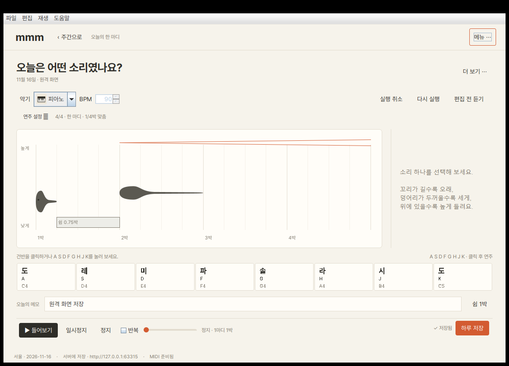

# MMM · 음음음 2.6.0

하루를 한 마디 소리와 메모로 남기는 **Java Swing 음악 기록 앱**입니다. 로컬 파일 모드와 **Java Spring Boot / PostgreSQL 원격 모드**를 지원합니다. 건반·시각 편집·MIDI·저장이 같은 음·쉼·표현 모델을 사용합니다.

개발명세서 v0.2와 GitHub 기준 커밋 `7e0702b`에서 이어 개발했습니다. 기존 2.4 로컬 배포본과 발표 자료는 보존했습니다.

2.5.1은 로그인·곡 생성/수정·음악 저장/수정의 성공·실패를 서버 창과 `%USERPROFILE%\.mmm\logs\activity.log`에 남깁니다. `devserver/view-logs.cmd`로 실시간 확인할 수 있습니다. [활동 로그 사용법](app/docs/ACTIVITY-LOGGING.md)을 참고하세요.

2.5.2에서는 콘솔 일시정지 때문에 서버 전체가 응답하지 않던 문제를 수정했습니다. 콘솔 출력 대기열이 가득 차도 회원가입·로그인·저장과 파일 로그 기록을 계속합니다. 시간 초과 안내도 가입·로그인에 맞게 구분합니다.

2.5.3은 C3–C6 범위의 흰/검은 피아노 건반으로 편집기를 바꿨습니다. 기존 A S D F G H J K와 검은 건반 W E T Y U, 클릭·드래그 연주를 지원합니다. [디자인과 조작 안내](app/docs/PIANO-DESIGN.md)를 참고하세요.

2.5.4는 건반 양옆 ‹ ›와 방향키로 한 옥타브씩 이동해 **C-1–G9, MIDI 128개 음**을 연주·편집·저장합니다. Home은 기본 음역으로 돌아갑니다. 확장한 음을 원격으로 저장하려면 서버와 클라이언트를 함께 업데이트하세요. 기존 DB의 계정과 기록을 유지하면서 음역 제한을 확장합니다.

2.6.0은 **피아노·베이스·기타·드럼**을 선택하면 각 악기에 맞는 연주 화면과 음색을 제공합니다. 베이스 4줄, 기타 6줄/코드·노트, 드럼 키트를 클릭하거나 키보드로 연주합니다. 기타 코드는 같은 박에 여러 음을 저장하고, 드럼은 전용 타악기 채널을 사용합니다. [악기별 연주 안내](app/docs/INSTRUMENT-SURFACES.md)를 참고하세요.

기본 입력은 **누른 길이대로**입니다. 누르는 순간 소리 그림이 나타나고, 누르고 있는 동안 청록색 꼬리가 자라며, 떼면 1/4박 단위의 길이로 확정됩니다. 기타·베이스·드럼은 악기 옆에서 그림을 함께 봅니다. [실시간 소리 그림](app/docs/LIVE-SOUND.md)을 참고하세요.



## 화면을 보면서 개발하기

Windows에서 **`preview.cmd`**를 실행하면 현재 소스를 빌드하고 샘플 계정의 편집 화면을 엽니다. 직접 건반·보관함·메뉴를 사용해 보며 다음 기능을 정할 수 있습니다. 서버 실행과 ZIP 교체 없이 같은 실행기를 계속 사용합니다.

수정 후 앱 상단의 **변경 반영 · F5**를 누르면 다시 빌드해 현재 곡과 화면을 엽니다. 미저장 입력은 기존 확인 절차로 저장하거나 버릴지 선택합니다. 샘플 저장은 `%USERPROFILE%\.mmm\development-preview`를 사용합니다. [미리보기 안내](app/docs/DEVELOPMENT-PREVIEW.md)를 참고하세요.

## Windows에서 바로 확인

Java 21을 권장합니다. Java 21로 빌드·전체 검사했고, 패키지 개발 서버의 Java 26 실행과 재시작 복원도 확인했습니다.

1. `devserver/start.cmd` 실행 → PostgreSQL을 포함한 개발 서버가 `http://127.0.0.1:8080`에서 시작합니다. 첫 실행은 Maven 의존성과 서버를 빌드합니다.
2. `app/remote.cmd` 실행 → 이 서버에 회원가입하고 로그인합니다.
3. 클라이언트를 하나 더 실행해 다른 계정으로 가입합니다. A가 공동 곡과 초대 코드를 만들면 B가 참여할 수 있습니다.
4. A에서 오늘 기록 저장 → B에서 공동 주간 **새로고침** → 같은 음·쉼·표현·메모를 조회하고 합주합니다.

`app/demo.cmd`는 2026-11-16 시연 모드, `app/run.cmd`는 로컬 일반 모드입니다. `MMM_SERVER_URL`을 설정하면 원격 모드로 실행합니다. 서로 다른 기기 연결은 HTTPS 서버 주소를 사용합니다.

서버 설정과 API는 [원격 개발·실행 안내](REMOTE.md), 편집 조작은 [앱 사용법](app/README.md)을 확인하세요.

## 빌드와 검증

```powershell
powershell.exe -NoProfile -ExecutionPolicy Bypass -File .\build-m2.ps1 -GuiTests
```

체크섬을 확인한 Maven 3.9.9를 작업용 `app/tools/`에 준비합니다. 설치한 JDK 또는 `JAVA_HOME`을 사용하며 이 폴더에 portable JDK 21이 있으면 우선 사용합니다. 일반 Maven 환경에서는 `mvn package -Dmmm.gui.tests=true`와 `app/build.sh`, `app/test-gui.sh`를 사용합니다.

- 클라이언트 기본 **182개**, 건반 **33개**, 전체 음역 **11개**, 악기·MIDI **16개** 통과. 일반 Swing **135개**, 개발 미리보기 **15개**, 악기별 화면 **31개** 통과.
- 실제 PostgreSQL·HTTP(S) 서버 시나리오 **24개** 통과. 드럼 저장·공유와 기존 악기 기록을 보존하는 V3 업그레이드를 포함합니다.
- 배포 개발 서버 JAR의 저장 → 정상 종료 → 재시작 후 계정·음·쉼·메모 복원 확인.

| 실행 파일 | 용도 |
|---|---|
| `app/build/MMM.jar` 또는 `app/target/MMM-client.jar` | 로컬·원격 공용 Swing 클라이언트 |
| `server/target/MMM-server-exec.jar` | 외부 PostgreSQL과 연결하는 일반 서버 |
| `devserver/target/MMM-dev-server.jar` | PostgreSQL을 함께 시작하는 로컬 개발 서버 |

`package-m2.ps1`은 Windows 실행 ZIP을 작업 폴더의 `output/development/`에 만듭니다. 런타임·계정·개인 기록·DB 비밀값은 포함하지 않습니다.

## 주요 기능

- 단계 입력·4박 실시간 녹음, 카운트인·메트로놈, 도레미 건반과 선택형 5음계
- 음 몸통/꼬리 드래그, 속성 조절, Undo/Redo, 편집 전후 비교
- 명시적 쉼 입력·변환·이동·길이 편집, 길이를 유지하는 스타카토, 구간 크레센도
- 공백 포함 20 코드포인트 메모, 주간 감상·합주·실시간 파트 음소거/음량
- 악보·MIDI·인쇄, 곡 관리·초대·탈퇴, 설정·도움말
- 서버 세션 인증, 서울 날짜·권한·버전 검사, 트랜잭션 저장과 요청 ID 재시도
- 로컬 schema 1/2 읽기·schema 3 쓰기와 백업. 원격 기록 schemaVersion은 2

독립 JVM의 네트워크 통신을 검증했습니다. 물리적으로 다른 두 기기와 인터넷 배포 환경, macOS 패키징, 실물 인쇄·청음 평가는 별도 확인 대상입니다. WebSocket 실시간 연주 스트리밍은 포함하지 않습니다.

- [M2 구현·검증 기록](app/docs/M2-VERIFICATION.md)
- [2.4 로컬 개발 이력](app/docs/DEVELOPMENT-v0.2.md)
- [서버 스키마](server/src/main/resources/db/migration/V1__initial.sql)


## 디자인 방향

현재 화면은 기능 검증용 구현입니다. 기존 색상·물방울·로고·배치는 유지 조건이 아니며, [최신 디자인 지침](app/docs/DESIGN.md)에 따라 재탐색합니다.
