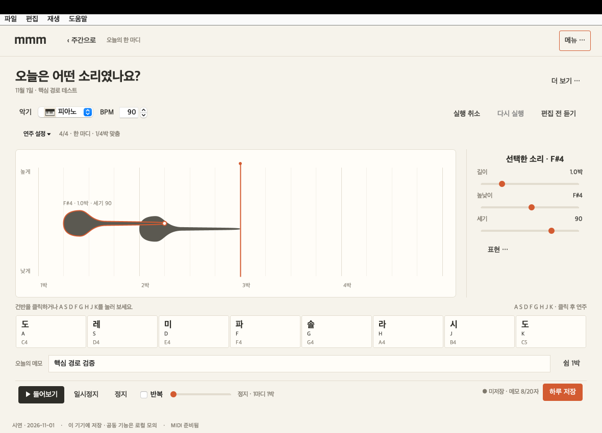

# MMM · 음음음

**하루를 한 마디 소리로 기록하는 Java Swing 데스크톱 앱.**

건반 연주 → 시각 편집 → 들어보기 → 저장 → 주간 감상까지 인터넷 없이 동작합니다. 지능형 UI/UX 프로그래밍 텀 프로젝트로, 그래픽·재생·저장이 같은 NoteEvent 모델을 사용합니다.



## 시작하기

Java 21 이상이 필요합니다. JDK를 설치하고 `JAVA_HOME`을 지정하세요.

```sh
git clone https://github.com/suimay/MMM.git
cd MMM/app
./build.sh
./demo.command
```

또는 [실행 JAR 다운로드](downloads/MMM-2.3.1.jar?raw=true) 후 실행합니다.

```sh
java -jar MMM-2.3.1.jar --demo-date=2026-11-01
```

시작 화면에서 **샘플 바로 듣기**를 누르거나 `demo / demo1234`로 로그인합니다. 이 계정은 공개 시연용입니다. 고정 날짜의 샘플 기록은 일반 모드 데이터와 분리됩니다.

## 주요 기능

- m 글자의 높이·너비로 소리를 만드는 프롤로그, 도레미파솔라시도 기본 건반
- 단계 입력·4박 녹음, 선택형 5음계, 카운트인·메트로놈
- 길이·세기·높낮이를 담은 소리 덩어리와 꼬리 드래그, 실행 취소/다시 실행, 편집 전후 비교
- 일시정지·반복·재생 위치 이동, 개인 주간·3파트 공동 합주
- 개인 요일 클릭으로 그날부터 이어 듣기, 공동 요일 클릭으로 그날 전체 합주
- 참여자×요일 공동 주간표, 소리 클릭으로 음 정보·메모 통합 감상
- 소리 일기장: 메모·소리 그림 모음, 검색·작성자·기간 필터, 메모 TXT 내보내기
- 작성자별 합주 타임라인과 연주 중인 음 표시, 실시간 파트 음소거·음량
- 개인 2곡·공동 2곡, 총 112개 샘플 기록
- 로컬 곡 관리·초대·참여, 시간 비례 악보·인쇄, MIDI 내보내기
- 날짜·권한·버전 검사, 원자적 파일 저장, 이전 정상 파일 백업
- 연구 근거를 확인하며 분위기 태그로 화음을 찾아 미리 듣고, 오늘의 한 마디에 삽입

## 감정·화음 기준표와 개발 안내

**[전체 브리핑](app/docs/emotion/README.md)**에서 기준표·파일 구조·Java 연결·검증 계획을 읽을 수 있습니다. 활성 태그 5개, 검증 대기 태그 5개, C 계열 화음 7개와 문헌 근거 연결 9개를 제공합니다. 연구의 평균 평정과 앱에서 재생하는 미검증 샘플을 별도로 관리합니다.

오늘 편집 화면의 **감정으로 화음 찾기**에서 태그 선택 → 화음 듣기 → 시작 박·길이 선택 → 이 화음 넣기로 사용합니다. 한 번의 실행 취소로 삽입한 화음 전체를 되돌릴 수 있습니다.

```sh
cd MMM/app
./review-emotions.command
```

이 명령은 소스를 빌드하고 화음 미리 듣기 창을 엽니다. macOS에서는 문서 폴더와 README도 함께 엽니다. Java 21 이상 JDK가 필요합니다. 소스 빌드 없이 확인하려면 **[감정·화음 기능 포함 JAR](downloads/MMM-emotion-preview.jar?raw=true)**를 Java 21 이상에서 실행하세요. 위의 기존 2.3.1 JAR에는 이 기능이 없습니다.

```sh
java -jar MMM-emotion-preview.jar --emotion-palette
java -jar MMM-emotion-preview.jar --demo-date=2026-11-01
```

- [화음별 기준표와 채택 규칙](app/docs/emotion/CRITERIA.md)
- [논문 7편·DOI·적용 범위](app/docs/emotion/SOURCES.md)
- [검증 결과와 사용자 청취 실험 계획](app/docs/emotion/VALIDATION.md)
- [앱이 읽는 태그·화음·근거 데이터](app/resources/mmm/emotion)

## 구현 범위

**Java Swing / Java Sound MIDI / 로컬 파일 저장**입니다. 서버 인증·Spring Boot·PostgreSQL·원격 협업은 미구현이며 공동 기능은 같은 기기의 로컬 모의 기능입니다. 악보는 시간 비례 간단 기보입니다.

모델·저장·기능 검사 **101개**, 실제 Swing 통합 검사 **73개**를 통과했습니다. 상세 범위와 검증 한계는 아래 문서에 기록했습니다.

- [화면 흐름·이벤트와 UX 검토](app/docs/UX-REVIEW.md)
- [디자인 기준·소리 덩어리의 의미](app/docs/DESIGN.md)
- [사용법·단축키·빌드·구현 구조](app/README.md)
- [화면별 Java 컴포넌트·이벤트 소개표](app/docs/components.md)
- [발표용 화면 캡처 묶음](app/docs/presentation-captures.zip)
- [검증 기록](app/docs/VERIFICATION.md)
- [Java 소스](app/src/main/java/mmm)
- [테스트](app/src/test/java/mmm)

개인 저장 데이터·계정 파일·JDK 설치본·macOS 앱 묶음은 저장소에 포함하지 않습니다. macOS에서는 `app/package-mac.sh`로 런타임을 포함한 앱을 만들 수 있습니다.
