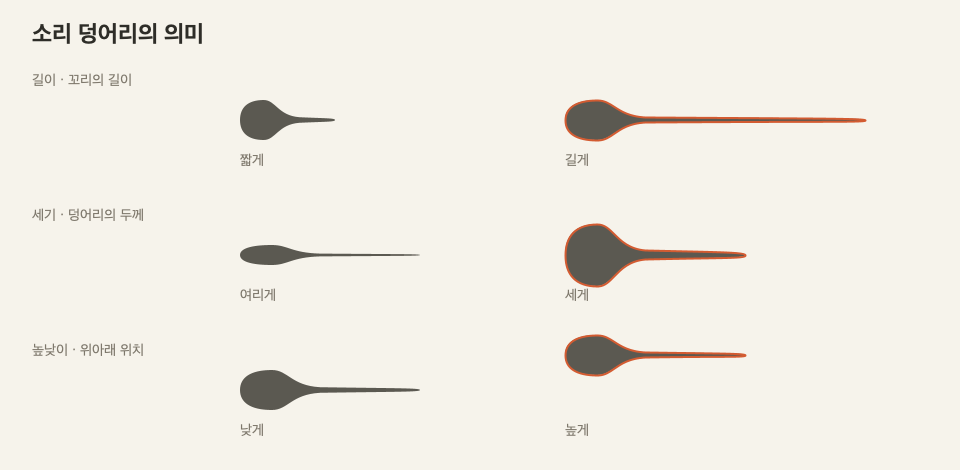

# MMM 2.3 · 일기 중심 디자인 기준

하루 한 마디를 만들고 다시 만나는 음악 일기. S06의 소리 덩어리가 작업의 중심이며, 주간·보관함은 그 소리와 메모를 발견하는 공간입니다.

## 소리 덩어리의 의미

기존 제안서의 몸통과 감쇠 꼬리를 유지합니다. 원통이나 균일한 캡슐로 치환하지 않습니다.

| 시각 요소 | NoteEvent | 실제 동작 |
|---|---|---|
| 가로 시작 위치 | start | MIDI note-on 시각 |
| 꼬리를 포함한 전체 길이 | duration | note-off까지의 시간 |
| 몸통 두께 | velocity | 발음 세기 |
| 위아래 위치 | pitch | MIDI 음높이 |

먹색은 기본 소리, 주황 윤곽과 꼬리 손잡이는 선택, 주황 채움과 재생선은 재생 중, 옅은 회색은 읽기 전용 감상입니다. 전체 드래그는 시작·높이, 꼬리 손잡이 드래그는 길이, 오른쪽 슬라이더는 길이·높이·세기를 바꿉니다. 겹친 음에서는 선택한 덩어리와 손잡이를 맨 위에 그립니다.

감쇠 곡선은 NoteEvent의 의미를 보여주는 도식입니다. 녹음된 파형이나 악기별 실제 음압 포락선을 측정한 값이 아닙니다. 존재하지 않는 표현 파라미터를 장식으로 꾸며 저장·소리와 어긋나게 만들지 않습니다. ‘짧게 끊기’는 duration을 줄이고, ‘점점 세게’는 음들의 velocity를 늘리므로 모양과 MIDI 모두 바뀝니다.

`SoundShape`의 동일 경로 생성기를 S06/S07, 보관함, 날짜 썸네일에서 사용합니다. 조형 변경은 저장 형식을 바꾸지 않습니다.

## 화면 구성

- 공통: 작은 워드마크, 문맥에 맞는 뒤로 가기, 현재 위치, 메뉴. 화면 ID는 내부 식별/접근성 정보로 유지하며 제목에 노출하지 않습니다.
- S04: 소리 썸네일·곡명·기록 수·최근 메모를 담은 곡 목록. 더블클릭/Enter로 열기. 개인·공동 탭은 유지합니다.
- S05/S08: 주 이동 → 7일 카드 → 기록 메모 또는 공동 참여자 표 → 주간 감상. 요일 재생과 기록 열기를 별도의 버튼으로 나눕니다. 지난 날 감상·오늘 편집·미래 잠금 정책은 그대로입니다.
- S06: 오늘의 제목/곡 → 기본 악기·BPM·비교 → 덩어리와 선택 속성 → 건반 → 메모 → 들어보기/하루 저장. 연주 옵션은 ‘연주 설정’, 내보내기는 ‘더 보기’, 선택 음의 추가 표현은 ‘표현’에서 엽니다.
- S01: 중앙 m 글자 세 개의 높이·너비로 음높이·길이를 체험한 뒤 도레미 건반과 기록으로 이어집니다.
- S07: 소리 모양·우측 선택 음 정보·하단 메모를 한 화면에서 감상합니다. 읽기 전용 선택은 가능하고 편집 입력은 등록하지 않습니다.
- S14: 날짜별 소리 그림과 메모를 모아 검색·작성자·기간으로 탐색합니다. 상세를 열고 돌아와도 필터와 선택을 유지합니다.
- 관리·악보·초대는 주간의 ‘곡 메뉴’에서 접근합니다. 설정·도움말은 앱 메뉴에 두어 편집 중 반복되는 전역 버튼을 줄입니다.

## 시각 규칙

- 배경: 아이보리 `#F6F3EB`, 내용 표면: `#FFFDF8`, 본문: `#2E2D28`, 보조: `#7E786C`, 구분선: `#E2DCCF`.
- 포인트: `#D35B31`. 저장과 선택 상태에 우선 사용합니다. 재생 버튼은 먹색으로 구분합니다.
- 글자: 제목 26px, 일반 14px, 보조 11~12px. 제목과 본문을 같은 강조도로 만들지 않습니다.
- 간격: 화면 외곽 24~30px, 영역 사이 16~20px, 관련 제어 사이 8px. 긴 버튼 줄로 서로 다른 작업을 혼합하지 않습니다.
- 버튼: 주 행동은 채움, 일반 조작은 조용한 텍스트, 필요한 입력 경계만 구분선. 포커스 윤곽은 유지합니다.
- 기본 창 1180×850, 최소 1060×780. 최소 창에서도 건반·선택 속성·저장이 안에 들어와야 합니다. 편집기 건반/저장은 고정하고, 통합 감상에서 공간이 부족하면 세로 스크롤로 캔버스·속성의 읽기 크기를 유지합니다.

## 검증 기준

길이 2배 → 꼬리 포함 너비 2배, velocity 증가 → 몸통 두께 증가, pitch 증가 → 위쪽 이동을 검사합니다. 캡슐과 달리 앞 몸통과 뒷 꼬리의 비대칭 단면도 검사합니다. 꼬리 드래그가 duration만 변경하고 MIDI 시각과 일치하는지, 실행 취소·저장·재실행에도 같은 음 데이터가 보존되는지 확인합니다.

실제 실행 화면: `S06-editor.png`, `S06-minimum.png`, `S05-saved.png`, `S04-library.png`.

