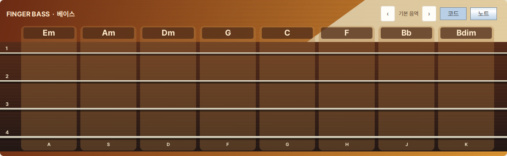
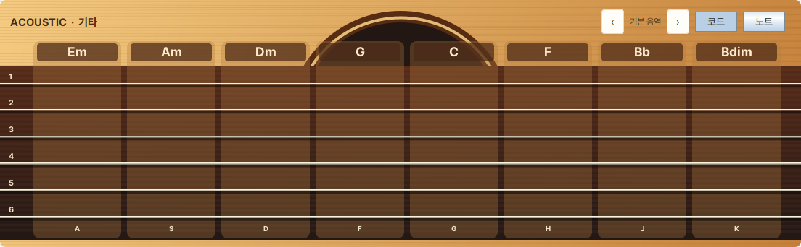
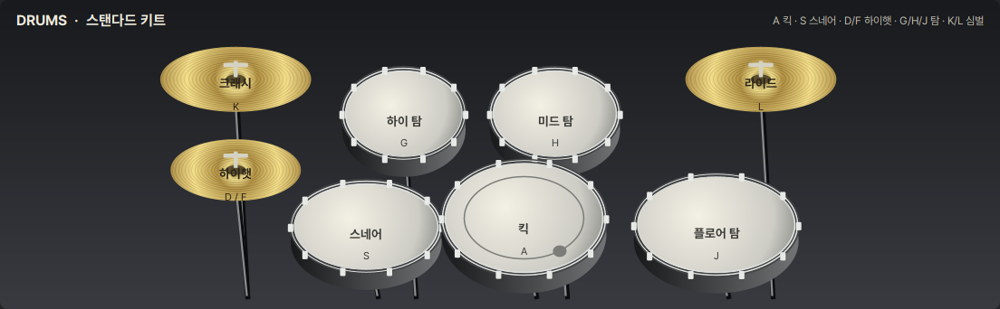

# 2.6.0 악기별 연주 화면 · 2026-11-17

사용자가 제공한 GarageBand 화면의 악기 구성과 상호작용을 참고해 앱의 Java2D 연주 화면을 만들었다. 제공된 앱 화면 자체를 배경으로 사용하지 않는다.

| 선택 | 연주 화면 | 소리 |
|---|---|---|
| 피아노 | 기존 흰/검은 건반, 음역 이동 | 어쿠스틱 피아노 |
| 베이스 | 4줄·선버스트 바디·코드/노트 | 핑거 일렉트릭 베이스 |
| 기타 | 6줄·우드 바디·사운드홀·코드/노트 | 어쿠스틱 기타 |
| 드럼 | 크래시·라이드·하이햇·하이/미드 탐·스네어·킥·플로어 탐 | 전용 GM 타악기 키트 |

악기를 선택하면 해당 연주 화면을 넓게 연다. **음 편집**을 누르면 기존 소리 그림과 속성으로 전환하고, **연주 화면**을 누르면 돌아온다. **새로 연주**는 확인 후 음·쉼·표현을 비우며 메모를 유지한다. 기존 저장본은 하루 저장 전까지 유지된다.

기본 입력은 **누른 길이대로**이며, 악기 옆의 소리 그림이 누르는 동안 자란다. 단계 입력과 4박 녹음은 **연주 설정**에서 선택한다. [실시간 소리 그림](LIVE-SOUND.md) 참조.

베이스와 기타의 **코드** 모드에서 A S D F G H J K는 Em/Am/Dm/G/C/F/Bb/Bdim에 대응한다. 베이스는 낮은 근음, 기타는 해당 코드의 여러 음을 같은 박에 입력한다. 코드 이름을 클릭해도 같은 동작이다. 줄을 직접 누르면 그 줄의 한 음을 연주한다. **노트** 모드는 0–12프렛을 직접 연주한다. 상단 ‹ ›와 좌우 방향키는 옥타브를 옮긴다. 피아노의 5음계 설정은 피아노 연주에 적용한다.

기타의 모든 코드는 6줄을 연주할 수 있다. Am·Dm·C·Bb·Bdim의 낮은 줄에는 해당 코드의 구성음을 넣었다. 강조와 주황 점은 직접 누른 코드 칸·줄에만 표시한다. 다른 칸에 같은 음이 있어도 함께 강조하지 않으며, 같은 음이 있는 다른 칸으로 드래그하면 새 위치에서 다시 연주한다. 키보드로 여러 코드를 누를 때는 누른 코드만 각각 표시한다.

드럼은 A 킥, S 스네어, D 닫힌 하이햇, F 열린 하이햇, G 하이 탐, H 미드 탐, J 플로어 탐, K 크래시, L 라이드다. 하이햇의 아래 부분은 열린 소리로 연주한다. 단계 입력은 한 번에 1/4박씩 넣고, 실시간 녹음은 친 시점을 1/4박에 맞춘다. 음 편집에서는 음높이 슬라이더 대신 타악기 이름을 선택한다.

## 소리와 저장

- 피아노 0·베이스 33·기타 24는 MIDI 프로그램, 드럼은 앱의 별도 ID 128로 저장한다. 드럼의 MIDI 출력은 채널 10(코드의 채널 9)과 킥 36·스네어 38 등의 타악기 음번호를 사용한다.
- 실시간 합주는 참여자의 논리 채널을 유지하면서 드럼만 타악기 채널로 보낸다. 드럼 참여자들의 음량·음소거와 같은 타악기의 음 해제를 구분하고 다른 참여자의 타격을 끊지 않는다. 멜로디 참여자는 기존 MIDI 음량 컨트롤을 유지한다.
- 이전 마림바 12·오르골 10 기록은 원래 소리를 유지한다. 그 기록을 열면 기존 악기 선택이 추가되며, 사용자가 새 악기를 선택할 때 바뀐다.
- 새 샘플의 별 파트는 베이스, 달 파트는 드럼으로 만든다. 이미 저장된 샘플과 사용자 기록은 덮어쓰지 않는다.
- 개발 미리보기는 F5로 반영한다. 원격 드럼 저장은 서버와 클라이언트를 2.6.0으로 업데이트한다. Flyway V3는 악기 ID 제약만 확장하며 기존 기록을 변환하지 않는다.
- 음원은 현재 Java MIDI 사운드뱅크를 사용한다. Apple GarageBand의 샘플 음원을 사용하지 않으며 장치의 사운드뱅크에 따라 음질이 달라질 수 있다.

소리 번호와 타악기 채널은 [MIDI Association의 General MIDI 규격](https://midi.org/general-midi-level-1), [Java MidiChannel](https://docs.oracle.com/en/java/javase/21/docs/api/java.desktop/javax/sound/midi/MidiChannel.html)을 기준으로 한다.

## 검증

악기·MIDI 16개, 실제 악기 화면 31개와 기존 기본/건반/음역 226개·일반 Swing 135개·미리보기 15개가 통과했다. 악기 화면 검사는 네 화면 전환, 실제 신디사이저의 베이스 프로그램과 드럼 채널, 기타 6음 동시 입력·한 번 실행 취소, 줄/프렛 클릭, 9개 타악기 클릭, 작은 창 배치, 저장 복원, 기존 악기 보존을 확인했다.

기타 입력 회귀 검사 81개가 추가로 통과했다. 8개 코드의 6줄 전체 발음과 코드 구성음, 같은 음을 가진 Am/Dm/F 칸의 강조 분리, 동시 코드와 마우스/키보드의 독립 해제, 드래그 재발음, 노트/베이스 표시 및 드럼 입력을 확인했다. 기록: `app/build/guitar-input-fix-tests.log`, 화면: `app/build/evidence/guitar-input-isolation.png`.

서버 통합 24개가 실패/오류/생략 없이 통과했다. 드럼 ID와 음을 다른 계정이 동일하게 조회하고, V2에서 V3 업그레이드 시 기존 악기·메모·음이 유지되는 것을 확인했다.

최종 전체 검사: `app/build/instruments-final-tests.log`. 실제 배포 JAR의 Java 26 검사: `app/build/instruments-jdk26.log`, `instruments-packaged-sound.log`. 서버 검사: `app/build/instruments-remote.log`. 빌드: `app/build/instruments-package.log`. 렌더링: `app/build/evidence/instrument-*.png`.
