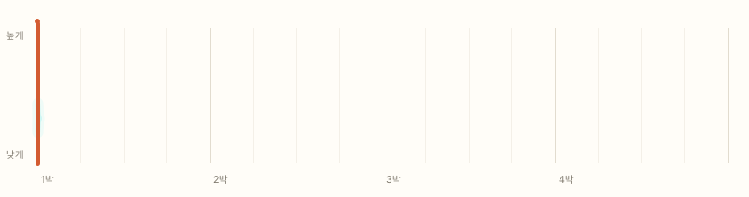
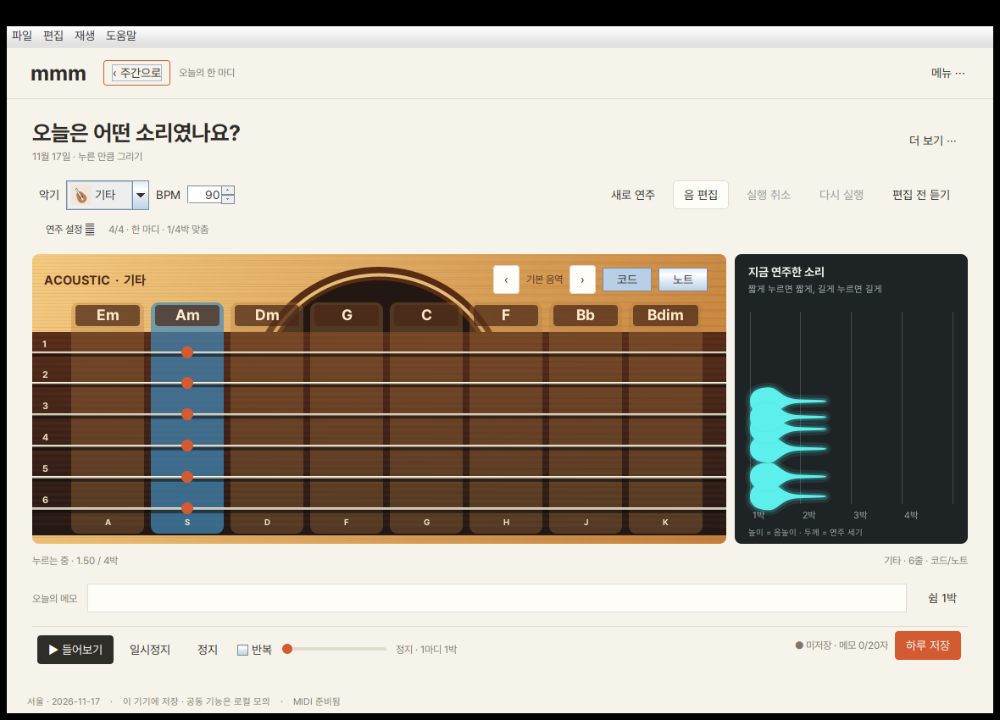

# 실시간 소리 그림 · 2026-11-17

미리보기에서 **F5**를 누르면 반영된다. 기존 한 마디가 가득 찼다면 **새로 연주**로 입력을 비운 뒤 연주한다.

기본 **누른 길이대로 · 바로 입력**은 누르는 순간 소리 몸통을 보여 주고, 누르고 있는 동안 꼬리가 계속 자란다. 떼면 그 길이를 확정하고 다음 음은 이어서 입력한다. 동시에 누른 음은 각 시작과 해제 시각을 보존한다. 기타 코드는 여러 음을 동시에 그리고 한 번의 실행 취소로 되돌린다.

피아노는 편집 캔버스에서, 베이스·기타·드럼은 악기 옆의 **지금 연주한 소리**에서 확인한다. 눌린 음은 밝은 청록색, 확정된 음은 어두운 청록색이다. 기본 캔버스에서는 확정된 음을 기존 먹색으로 표시하고 길이·세기 등을 편집한다.

- 길이: 누른 시간. 화면은 30ms 간격으로 갱신하며 저장 시 1/4박에 맞춘다. 4박 끝에서 자동 확정한다.
- 높이: 음높이. 높은 음일수록 위에 그린다.
- 두께: **연주 설정 → 연주 세기**. 일반 키보드와 마우스에서는 압력을 측정하지 않고 이 설정을 실제 MIDI 발음과 기록에 함께 적용한다.
- **연주 설정 → 단계 입력**은 기존 고정 1박 입력이다. 드럼의 단계 입력은 1/4박이다.
- **실시간 입력 → 녹음 시작**은 기존 4박 타임라인에 녹음하며 누르는 중인 멜로디 음도 바로 그린다. 이 모드의 드럼은 짧은 타격으로 기록한다.

입력 중 정지·모드 변경·악기 변경·F5·이동으로 연주를 끝낼 때도 보류 중인 음을 먼저 확정한다. 미확정 길이를 저장 모델에 임시 음으로 넣지 않고 별도의 미리보기로 그리며, 확정 후 기존 NoteEvent 모델·저장·MIDI·악보를 사용한다. DB 변경은 필요 없다.

기본 검사 323개와 Swing 검사 218개가 통과했다. 새 동작은 `LiveSoundGuiTest`의 37개 검사로 확인했다. 실제 `app/target/MMM-client.jar`를 Java 26에서 실행한 검사도 통과했다. 검사는 별도 임시 계정과 저장소를 사용한다. 상세 로그는 `app/build/live-sound-tests.log`, `live-sound-jdk26.log`, `live-sound-package.log`다.
