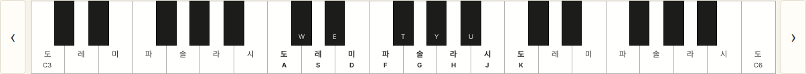
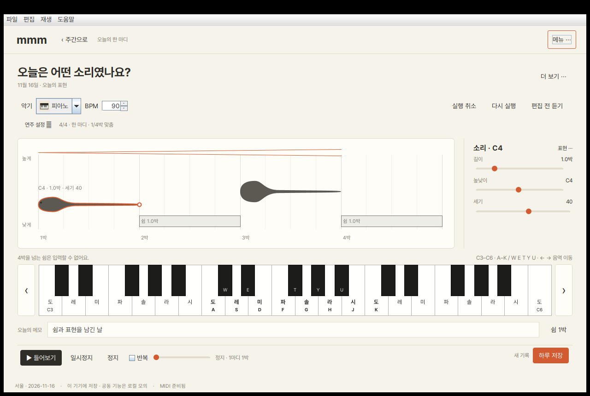

# 2.5.4 피아노 건반과 음역 이동 · 2026-11-16

[사용자가 제공한 Pinterest 디자인](https://www.pinterest.com/pin/947233734116294051/)의 흰 건반과 2개·3개 묶음 검은 건반을 참고해 Swing 컴포넌트로 직접 그렸다. 참고 사진을 앱의 배경 이미지로 사용하지 않는다. 창 크기에 따라 실제 건반과 클릭 영역이 함께 맞춰진다.

- 기본 C3–C6의 3옥타브: 흰 건반 22개, 검은 건반 15개. 검은 건반은 흰 건반 높이의 62%다. 양옆 ‹ ›로 한 옥타브씩 이동해 MIDI 0–127(C-1–G9)에 접근한다. 마지막 화면은 C7–G9로 끝난다.
- 흰 면·먹색 면·얇은 회색 구분선과 각진 모서리를 사용한다. 누른 음은 앱의 주황색으로 표시한다.
- 작은 창에서는 건반 높이를 84px로 줄여 음높이 편집 영역과 메모·저장을 함께 확보한다.
- 기본 흰 건반 단축키 A S D F G H J K는 C4 D4 E4 F4 G4 A4 B4 C5다. 음역 이동에 따라 단축키 음높이도 한 옥타브씩 바뀐다.
- 기본 검은 건반 W E T Y U는 C♯4 D♯4 F♯4 G♯4 A♯4다. 전체 음역은 마우스로 클릭하거나 누른 채 옆으로 이동해 연주한다. 건반의 ← →도 음역을 옮기고 Home은 기본 음역으로 돌아간다.
- 흰 건반 아래 영역을 누르면 그 흰 음이, 겹치는 검은 영역을 누르면 반음이 난다. 미/파·시/도 사이에는 검은 건반을 만들지 않는다.
- 5음계는 모든 옥타브에서 도·레·미·솔·라만 활성화한다. 기존 5음계 A–K 매핑(C4 D4 E4 G4 A4 C5 D5 E5)을 유지하고 해당 위치에 단축키를 표시한다. 검은 건반과 파·시는 쉬는 상태로 표시한다.
- 키 반복 입력을 차단하고, 같은 음을 마우스와 키보드로 함께 잡은 경우 마지막 입력을 놓을 때 한 번 해제한다. 포커스가 바뀌거나 화면을 떠나면 모든 음을 해제한다.
- 음역을 이동할 때 누른 음을 먼저 해제한다. 양 끝에서는 해당 화살표를 비활성화한다. 이동 자체는 음악 초안을 수정하지 않으며 높낮이 슬라이더도 0–127을 지원한다. 소리 그림·썸네일·합주는 저장한 음역에 맞춰 표시하고 악보는 범위에 따라 높이와 페이지를 확보한다.

## 검증

`PianoTest`의 33개 검사로 클릭 영역, 단축키, 음 해제, 모든 페이지 순회의 128음 접근, 양 끝 제한과 Home 복귀를 확인했다. `PitchRangeTest`의 11개 검사로 전체 MIDI 범위·로컬 저장 복원·실제 MIDI 음번호·그리기·악보를 확인했다. 기본 182개와 실제 Swing 흐름 135개도 통과했다.

`app/build.ps1 -GuiTests` 또는 `app/build.sh`로 기본 검사를 실행한다. 실제 Swing 편집·저장·실시간 입력·최소 1000×720에서 양옆 버튼 배치도 확인한다. 실행 기록은 `app/build/pitch-range-tests.log`, 화면은 `app/build/evidence/`에 보관한다.

서버 통합 22개는 실패/오류/생략 없이 통과했다. 음역을 옮긴 원격 Swing의 C♯7 입력·다른 사용자 조회, MIDI 0/127 공유·범위 밖 거부와 V1 기록을 보존하는 DB 업그레이드가 포함된다. 실행 기록은 `app/build/pitch-range-remote.log`다.

Java 26의 실제 배포 JAR로 건반 33개·전체 음역 11개도 통과했다. 2.5.3 배포본에서 임시 DB에 계정·곡·C4 기록을 저장하고 정상 종료한 뒤, 같은 DB를 2.5.4로 열어 기존 메모/음/버전을 확인했다. 이어 MIDI 0/127을 버전 2로 저장하고 다시 재시작해 그대로 복원했다. 활동 로그도 확인했다. 기록: `app/build/pitch-upgrade-packaged.log`. 개인 DB와 실행 중인 사용자의 서버는 수정하지 않았다.

원격 사용은 서버와 모든 클라이언트를 2.5.4로 업데이트한다. 기존 서버를 `stop`으로 종료하고 새 `start-server.cmd`를 시작한 뒤 `remote.cmd`를 실행한다. Flyway V2는 노트 음역 제약만 0–127로 확장하고 기존 계정·음 데이터는 유지한다. V1 마이그레이션은 수정하지 않았다.
