# MMM 화면별 Java 컴포넌트·이벤트 소개표

실제 Swing 실행 중 생성된 컴포넌트 트리와 `mmm.*` 코드가 등록한 리스너를 수집했습니다. 공통 메뉴·작업 표시와 접혀 있는 설정을 포함하며, 운영체제 기본 리스너는 이벤트 수에서 제외했습니다. 목록/표 셀 렌더러처럼 필요 시 재사용되는 객체는 트리 수에 전부 들어가지 않아 역할 설명을 함께 보세요. JLabel(ImageIcon)은 JLabel의 이미지 사용 표시이며 별도 컴포넌트 클래스로 세지 않습니다.

## PPT에 넣을 요약

| 화면 | 사용자 기능·시연 행동 | 주요 컴포넌트 | 이벤트 | 실행 캡처 |
|---|---|---|---|---|
| S01 · 시작·소리 체험 | m 글자의 높이·너비로 음높이·길이를 바꾸고 세 음 이어 듣기, 도레미 건반 체험 | JLabel(ImageIcon), JComboBox, JPanel, JSlider, JButton | ItemListener, KeyListener, MouseListener, MouseMotionListener, FocusListener, ChangeListener | [보기](S01-start.png) |
| S02 · 로그인 | 아이디·비밀번호 검증 후 로컬 로그인 | JTextField, JPasswordField, JButton, JLabel | ActionListener, WindowListener | [보기](S02-login.png) |
| S03 · 회원가입 | 입력 오류·중복 계정 검사 및 가입 | JTextField, JPasswordField, JLabel, JButton | ActionListener, DocumentListener | [보기](S03-signup.png) |
| S04 · 곡 보관함 | 검색·정렬·더블클릭·Enter로 개인/공동 곡 열기 | JTabbedPane, JList, JScrollPane, JTextField, JComboBox | DocumentListener, MouseListener, ActionListener | [보기](S04-library.png) |
| S05 · 개인 주간 | 요일 클릭으로 그날부터 이어 듣기, 별도 버튼으로 기록 열기·오늘 편집 | JPanel, JButton, JTextArea, JSlider, JCheckBox | ActionListener, ChangeListener, MouseListener | [보기](S05-personal.png) |
| S06 · 오늘의 한 마디 | 덩어리·꼬리 드래그, 길이·높이·세기 조절, 비교·저장 | JPanel, JSlider, JSpinner, JComboBox, JTextField | KeyListener, MouseListener, MouseMotionListener, ChangeListener, DocumentListener | [보기](S06-editor.png) |
| S07 · 기록 상세·감상 | 소리 클릭 → 우측 음 정보, 메모를 같은 화면에서 확인·선택 음 감상 | JSplitPane, JPanel, JTable, JTextPane, JToggleButton, JLabel(ImageIcon) | MouseListener, ListSelectionListener, ItemListener, ActionListener | [보기](S07-listen.png) |
| S08 · 공동 주간 | 요일 클릭은 그날 전체 합주, 날짜 칸 클릭은 참여자 기록, 참여자 한 주 듣기 | JTable, JSplitPane, JToggleButton, JButton | ListSelectionListener, MouseListener, ActionListener | [보기](S08-shared.png) |
| S09 · 공동 합주·파트 | 작성자별 타임라인·연주 음 표시·실시간 파트 음소거/음량 | JToolBar, JList, JCheckBox, JSlider, JTabbedPane, JPopupMenu | ListSelectionListener, MouseListener, MouseMotionListener, MouseWheelListener, ChangeListener | [보기](S09-ensemble.png) |
| S10 · 곡·참여자 관리 | 소유자만 곡 설정 변경, 초대·참여·탈퇴 | JTextField, JSpinner, JTable, JButton | ActionListener, ChangeListener | [보기](S10-management.png) |
| S11 · 악보·출력 | 악보 확대·페이지 인쇄·MIDI 내보내기 | JPanel, JComboBox, JScrollPane, JFileChooser | ActionListener | [보기](S11-score.png) |
| S12 · 설정·계정 | 음량·기본 악기·카운트인·메트로놈 설정 저장 | JTabbedPane, JSlider, JComboBox, JCheckBox, JSpinner | ActionListener, ChangeListener | [보기](S12-settings.png) |
| S13 · 도움말·수업 요소 | 주제 선택으로 화면의 기능·컴포넌트·이벤트 설명 탐색 | JTree, JEditorPane, JSplitPane, JScrollPane | TreeSelectionListener, HyperlinkListener | [보기](S13-help.png) |
| S14 · 소리 일기장 | 소리 그림과 메모 모음, 날짜·작성자·검색 필터, 선택 기록 감상과 메모 TXT 내보내기 | JList, JTextField, JComboBox, JCheckBox, JSplitPane, JTextPane, JFileChooser | DocumentListener, ItemListener, ListSelectionListener, MouseListener, ActionListener | [보기](S14-journal.png) |

## 합주 발표 시연 순서

1. S08: 별(샘플)의 날짜 칸 선택 → 작성자·악기·소리 모양 확인.
2. 기록 자세히 → S07에서 소리 덩어리 클릭 → 우측 도 C3·시작 박·길이·세기와 하단 메모 확인 → 선택 음 듣기.
3. 돌아가기 → 함께 듣기 → S09에서 내 소리/친구 소리/모두 비교.
4. 재생 중 체크박스·슬라이더로 파트 음소거/음량을 바꾸고, 반복·정지·위치 이동 시연.
5. 소리 일기장에서 작성자·기간·메모를 검색하고 선택한 날 듣기.
6. 수업 요소 안내에서 JTree 항목 선택 → JEditorPane 설명과 이벤트 연결 소개.

추가 캡처: [친구 기록](S07-friend.png), [실시간 합주](S09-playing.png), [개별 음 정보](S09-part-detail.png), [JTree 수업 안내](S13-components.png).

## 지원 API와 배치 (Swing 컴포넌트와 구분)

Graphics2D·AffineTransform: 소리 덩어리/글자/일기 그림 렌더링. BorderLayout·GridLayout·BoxLayout: 화면 배치. AbstractTableModel·DefaultTreeModel·ListModel·TableRowSorter: 데이터와 정렬. UndoManager: 실행 취소. SwingWorker: 파일 작업과 화면 응답. PrinterJob: 인쇄. javax.swing.Timer: 재생 위치와 음의 시각 피드백. InputMap/ActionMap: 키보드 접근.

주요 페이지의 UX 선택 이유와 행동→이벤트→피드백 연결은 [UX 검토](UX-REVIEW.md)를 함께 보세요.

## D01 실제 구성

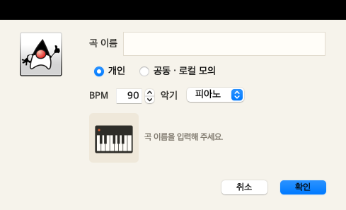

- 컴포넌트: JButton ×2, JComboBox ×1, JDialog ×1, JLabel ×6, JLabel(ImageIcon) ×1, JOptionPane ×1, JPanel ×12, JRadioButton ×2, JSpinner ×1, JTextField ×2
- 앱 코드가 등록한 이벤트: ChangeListener ×1, DocumentListener ×1, ItemListener ×2
- 배치 관리자: AquaButtonAreaLayout, AquaComboBoxLayoutManager, BorderLayout, BoxLayout, FlowLayout, GridBagLayout, NumberEditor, RootLayout, SpinnerLayout, UpdateHandler

## D02 실제 구성

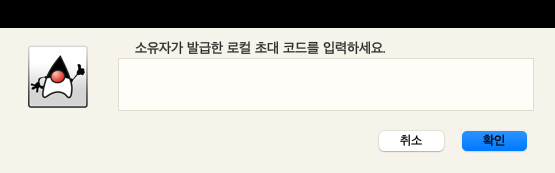

- 컴포넌트: JButton ×2, JDialog ×1, JLabel ×2, JOptionPane ×1, JPanel ×7, JTextField ×1
- 앱 코드가 등록한 이벤트: 
- 배치 관리자: AquaButtonAreaLayout, BorderLayout, BoxLayout, FlowLayout, GridBagLayout, RootLayout, UpdateHandler

## D03 실제 구성

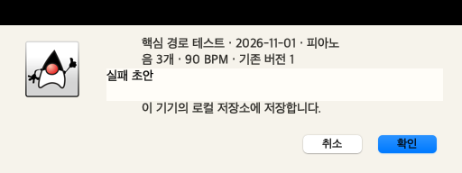

- 컴포넌트: JButton ×2, JDialog ×1, JLabel ×4, JOptionPane ×1, JPanel ×7, JTextArea ×1
- 앱 코드가 등록한 이벤트: 
- 배치 관리자: AquaButtonAreaLayout, BorderLayout, BoxLayout, FlowLayout, GridBagLayout, RootLayout, UpdateHandler

## D04 실제 구성

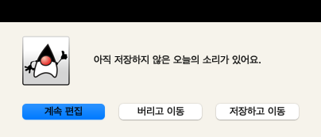

- 컴포넌트: JButton ×3, JDialog ×1, JLabel ×2, JOptionPane ×1, JPanel ×6
- 앱 코드가 등록한 이벤트: 
- 배치 관리자: AquaButtonAreaLayout, BorderLayout, BoxLayout, FlowLayout, GridBagLayout, RootLayout

## D05 실제 구성

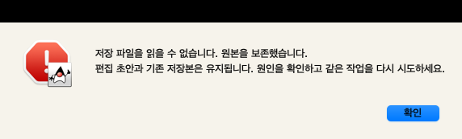

- 컴포넌트: JButton ×1, JDialog ×1, JLabel ×3, JOptionPane ×1, JPanel ×6
- 앱 코드가 등록한 이벤트: 
- 배치 관리자: AquaButtonAreaLayout, BorderLayout, BoxLayout, FlowLayout, GridBagLayout, RootLayout

## S01 실제 구성

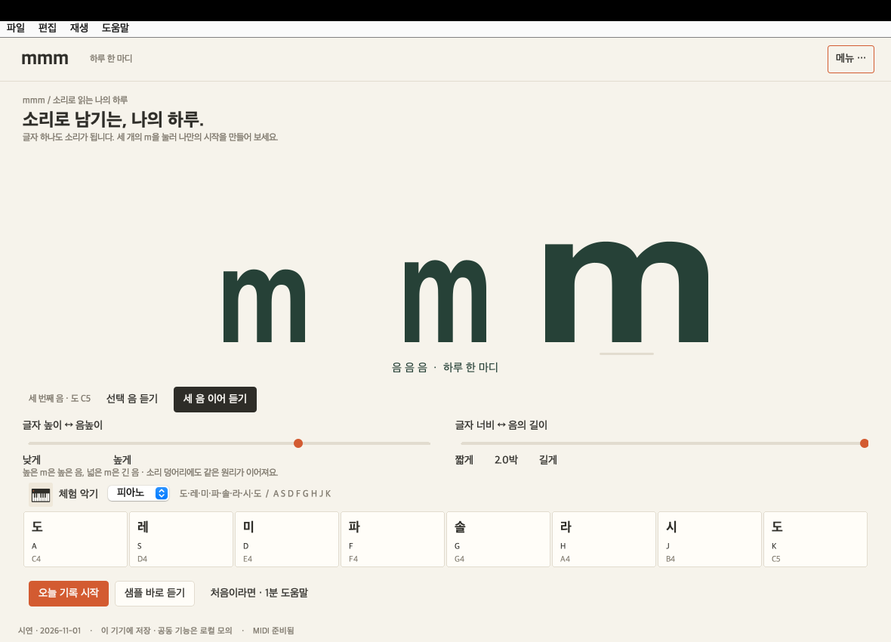

- 컴포넌트: JButton ×7, JComboBox ×1, JFrame ×1, JLabel ×16, JLabel(ImageIcon) ×1, JMenu ×4, JMenuBar ×1, JPanel ×18, JProgressBar ×1, JSlider ×2
- 앱 코드가 등록한 이벤트: ActionListener ×8, ChangeListener ×2, FocusListener ×1, ItemListener ×1, KeyListener ×2, MouseListener ×3, MouseMotionListener ×1, WindowFocusListener ×1, WindowListener ×1
- 배치 관리자: AquaComboBoxLayoutManager, BorderLayout, BoxLayout, CardLayout, FlowLayout, GridBagLayout, GridLayout, RootLayout

## S02 실제 구성

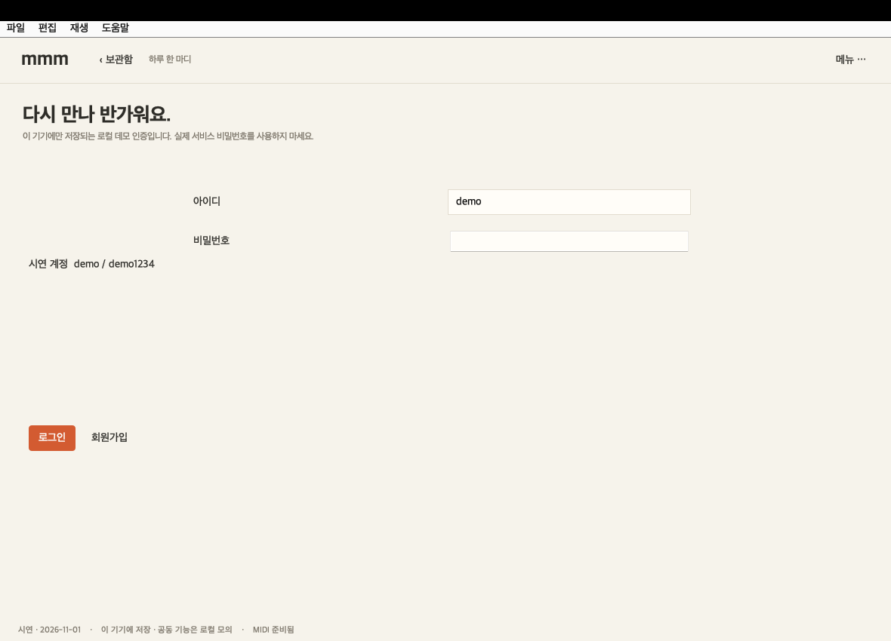

- 컴포넌트: JButton ×4, JFrame ×1, JLabel ×9, JMenu ×4, JMenuBar ×1, JPanel ×11, JPasswordField ×1, JProgressBar ×1, JTextField ×1
- 앱 코드가 등록한 이벤트: ActionListener ×5, KeyListener ×1, MouseListener ×1, WindowFocusListener ×1, WindowListener ×1
- 배치 관리자: BorderLayout, BoxLayout, CardLayout, FlowLayout, GridBagLayout, GridLayout, RootLayout, UpdateHandler

## S03 실제 구성

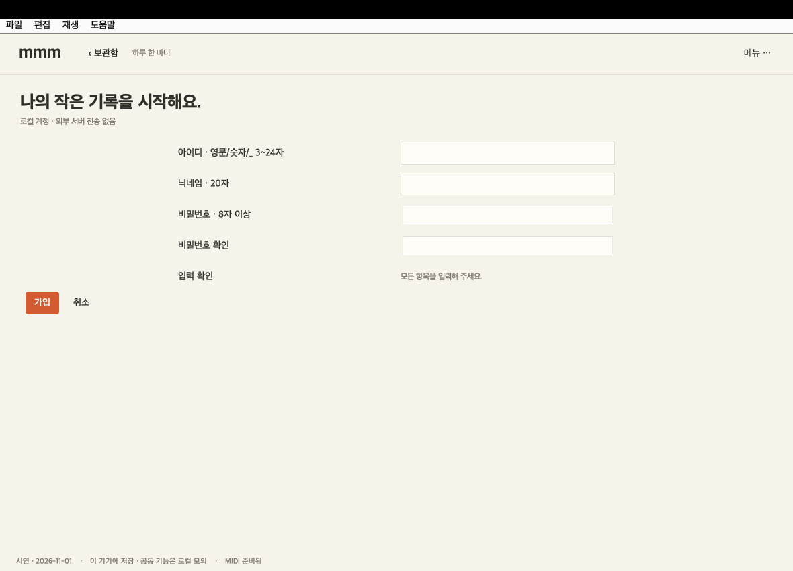

- 컴포넌트: JButton ×4, JFrame ×1, JLabel ×12, JMenu ×4, JMenuBar ×1, JPanel ×10, JPasswordField ×2, JProgressBar ×1, JTextField ×2
- 앱 코드가 등록한 이벤트: ActionListener ×5, DocumentListener ×4, KeyListener ×1, MouseListener ×1, WindowFocusListener ×1, WindowListener ×1
- 배치 관리자: BorderLayout, BoxLayout, CardLayout, FlowLayout, GridBagLayout, GridLayout, RootLayout, UpdateHandler

## S04 실제 구성

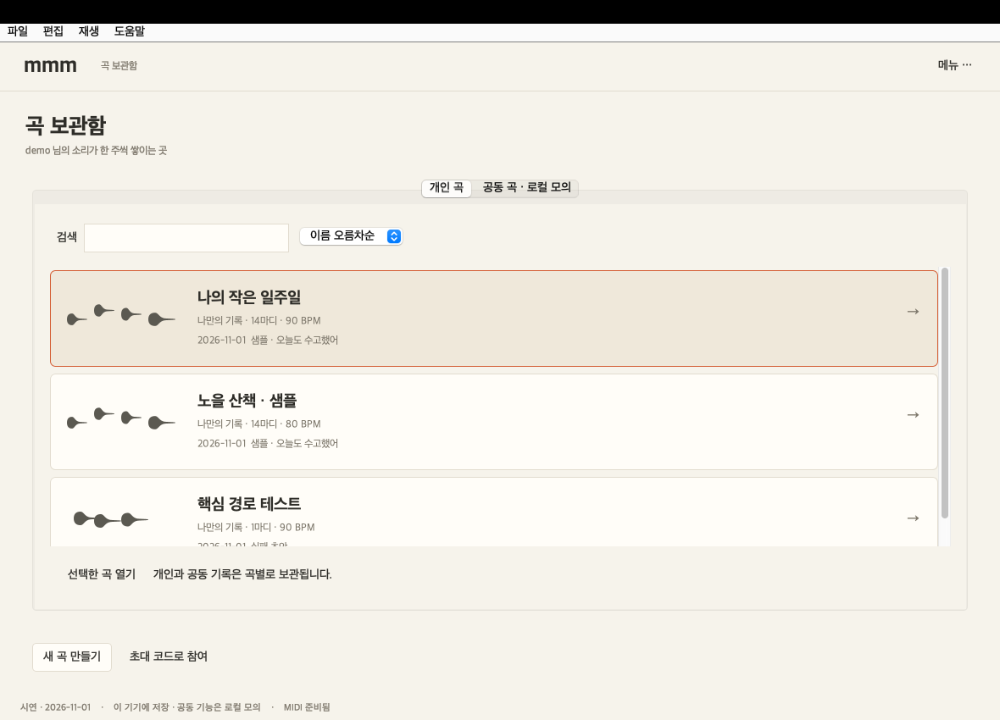

- 컴포넌트: JButton ×6, JComboBox ×2, JFrame ×1, JLabel ×10, JList ×2, JMenu ×4, JMenuBar ×1, JPanel ×15, JProgressBar ×1, JScrollPane ×2, JTabbedPane ×1, JTextField ×2
- 앱 코드가 등록한 이벤트: ActionListener ×9, DocumentListener ×2, KeyListener ×1, MouseListener ×3, WindowFocusListener ×1, WindowListener ×1
- 배치 관리자: AquaComboBoxLayoutManager, AquaTruncatingTabbedPaneLayout, BorderLayout, BoxLayout, CardLayout, FlowLayout, GridBagLayout, RootLayout, UIResource, UpdateHandler, ViewportLayout

## S05 실제 구성

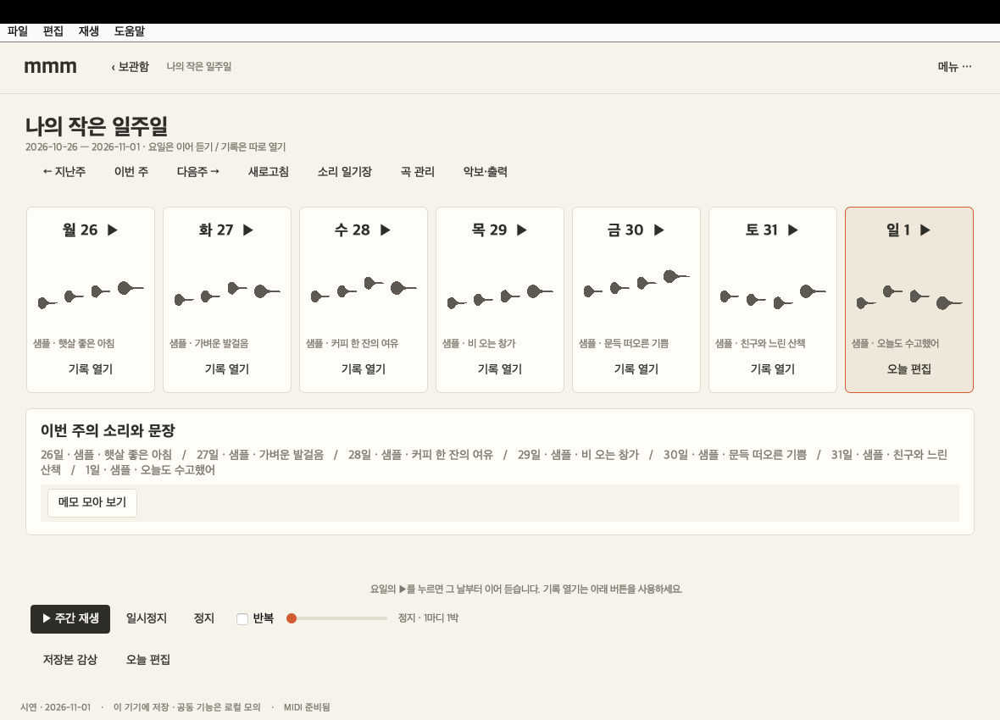

- 컴포넌트: JButton ×29, JCheckBox ×1, JFrame ×1, JLabel ×16, JMenu ×4, JMenuBar ×1, JPanel ×37, JProgressBar ×1, JSlider ×1, JTextArea ×1
- 앱 코드가 등록한 이벤트: ActionListener ×31, ChangeListener ×1, KeyListener ×1, MouseListener ×1, WindowFocusListener ×1, WindowListener ×1
- 배치 관리자: BorderLayout, BoxLayout, CardLayout, FlowLayout, GridBagLayout, GridLayout, RootLayout, UpdateHandler

## S06 실제 구성

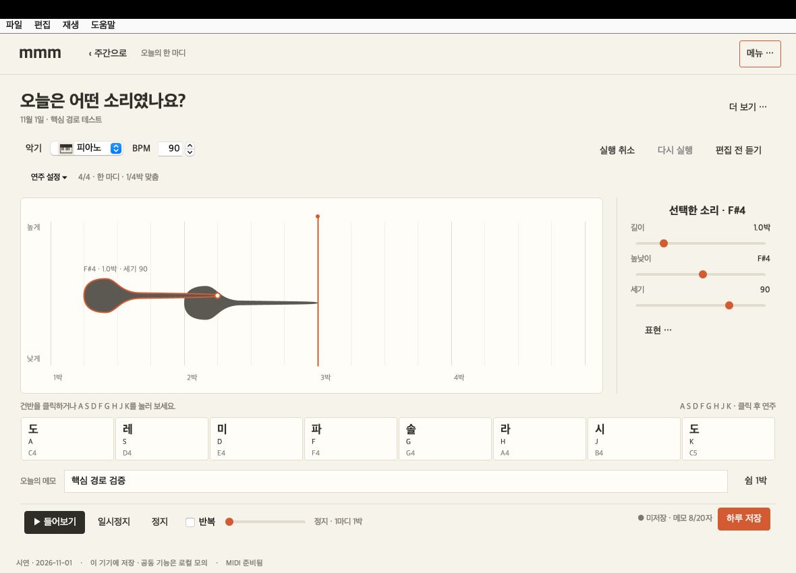

- 컴포넌트: JButton ×14, JCheckBox ×2, JComboBox ×2, JFrame ×1, JLabel ×22, JMenu ×4, JMenuBar ×1, JPanel ×37, JProgressBar ×1, JSlider ×4, JSpinner ×1, JTextField ×2, JToggleButton ×1
- 앱 코드가 등록한 이벤트: ActionListener ×20, ChangeListener ×5, DocumentListener ×1, FocusListener ×1, KeyListener ×2, MouseListener ×3, MouseMotionListener ×1, WindowFocusListener ×1, WindowListener ×1
- 배치 관리자: AquaComboBoxLayoutManager, BorderLayout, BoxLayout, CardLayout, FlowLayout, GridBagLayout, NumberEditor, RootLayout, SpinnerLayout, UpdateHandler

## S07 실제 구성

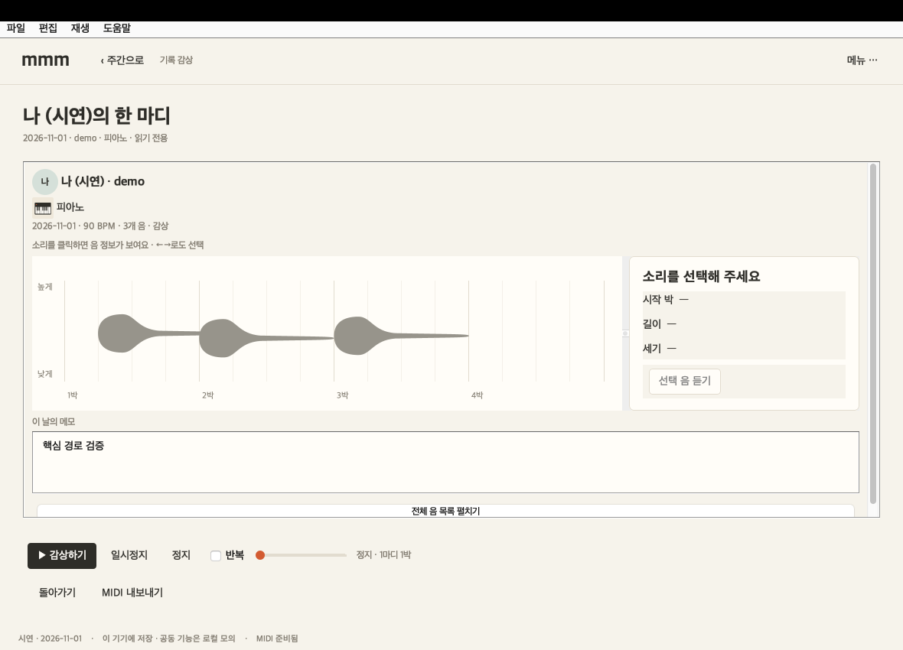

- 컴포넌트: JButton ×8, JCheckBox ×1, JFrame ×1, JLabel ×16, JLabel(ImageIcon) ×2, JMenu ×4, JMenuBar ×1, JPanel ×20, JProgressBar ×1, JScrollPane ×3, JSlider ×1, JSplitPane ×1, JTable ×1, JTextPane ×1, JToggleButton ×1
- 앱 코드가 등록한 이벤트: ActionListener ×10, ChangeListener ×1, ItemListener ×1, KeyListener ×1, ListSelectionListener ×1, MouseListener ×2, WindowFocusListener ×1, WindowListener ×1
- 배치 관리자: BasicHorizontalLayoutManager, BorderLayout, BoxLayout, CardLayout, DividerLayout, FlowLayout, GridBagLayout, GridLayout, RootLayout, UIResource, UpdateHandler, ViewportLayout

## S08 실제 구성

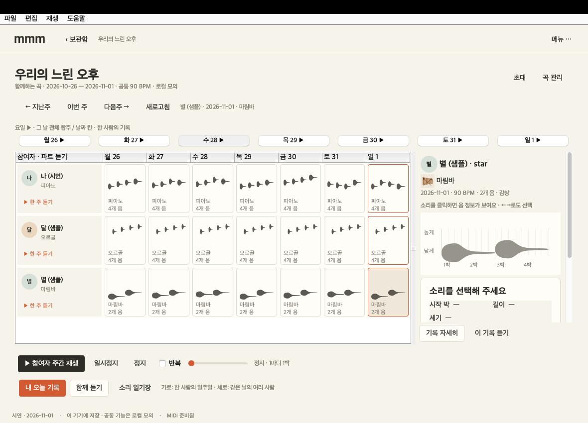

- 컴포넌트: JButton ×17, JCheckBox ×1, JFrame ×1, JLabel ×19, JLabel(ImageIcon) ×2, JMenu ×4, JMenuBar ×1, JPanel ×30, JProgressBar ×1, JScrollPane ×4, JSlider ×1, JSplitPane ×1, JTable ×2, JTextPane ×1, JToggleButton ×8
- 앱 코드가 등록한 이벤트: ActionListener ×26, ChangeListener ×1, ItemListener ×1, KeyListener ×1, ListSelectionListener ×3, MouseListener ×4, WindowFocusListener ×1, WindowListener ×1
- 배치 관리자: BasicHorizontalLayoutManager, BorderLayout, BoxLayout, CardLayout, DividerLayout, FlowLayout, GridBagLayout, GridLayout, RootLayout, UIResource, UpdateHandler, ViewportLayout

## S09 실제 구성

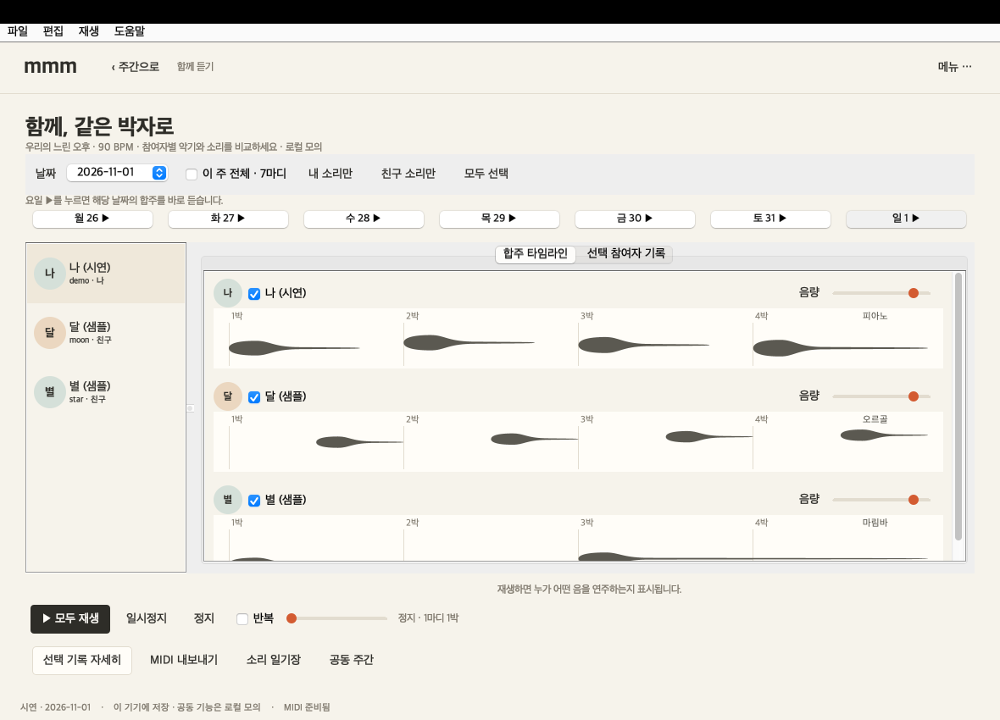

- 컴포넌트: JButton ×13, JCheckBox ×5, JComboBox ×1, JFrame ×1, JLabel ×25, JLabel(ImageIcon) ×5, JList ×1, JMenu ×4, JMenuBar ×1, JPanel ×34, JProgressBar ×1, JScrollPane ×5, JSlider ×4, JSplitPane ×2, JTabbedPane ×1, JTable ×1, JTextPane ×1, JToggleButton ×8, JToolBar ×1
- 앱 코드가 등록한 이벤트: ActionListener ×27, ChangeListener ×5, ItemListener ×1, KeyListener ×1, ListSelectionListener ×2, MouseListener ×8, MouseMotionListener ×3, MouseWheelListener ×3, WindowFocusListener ×1, WindowListener ×1
- 배치 관리자: AquaComboBoxLayoutManager, AquaTruncatingTabbedPaneLayout, BasicHorizontalLayoutManager, BorderLayout, BoxLayout, CardLayout, DividerLayout, FlowLayout, GridBagLayout, GridLayout, RootLayout, UIResource, UpdateHandler, ViewportLayout

## S10 실제 구성

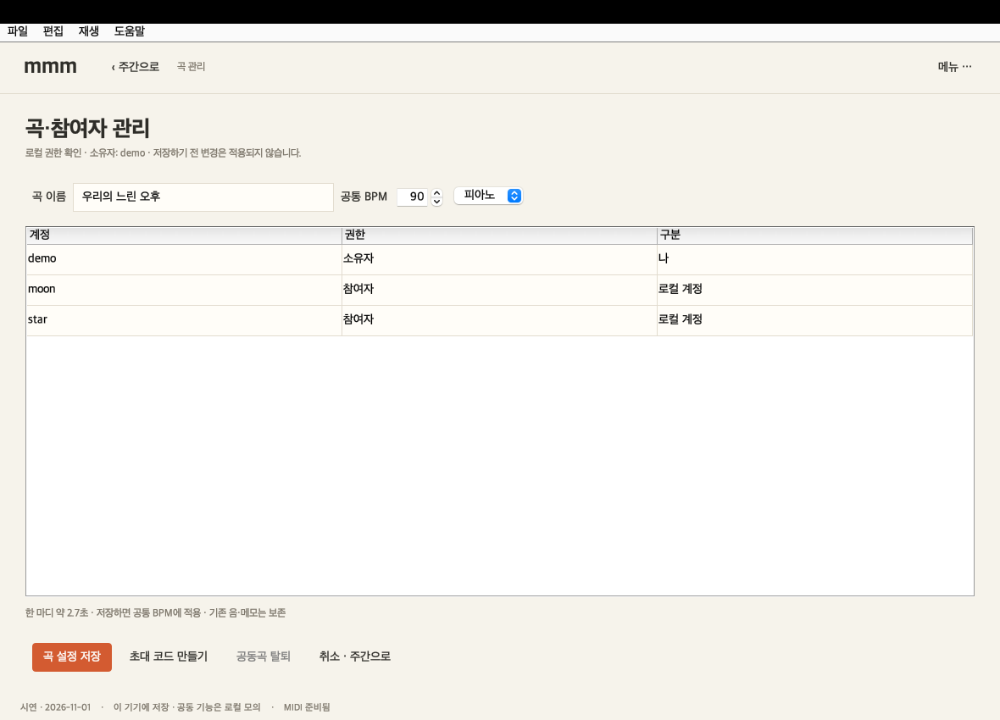

- 컴포넌트: JButton ×6, JComboBox ×1, JFrame ×1, JLabel ×9, JMenu ×4, JMenuBar ×1, JPanel ×11, JProgressBar ×1, JScrollPane ×1, JSpinner ×1, JTable ×1, JTextField ×2
- 앱 코드가 등록한 이벤트: ActionListener ×7, ChangeListener ×1, KeyListener ×1, ListSelectionListener ×1, MouseListener ×1, WindowFocusListener ×1, WindowListener ×1
- 배치 관리자: AquaComboBoxLayoutManager, BorderLayout, BoxLayout, CardLayout, FlowLayout, GridBagLayout, NumberEditor, RootLayout, SpinnerLayout, UIResource, UpdateHandler, ViewportLayout

## S11 실제 구성

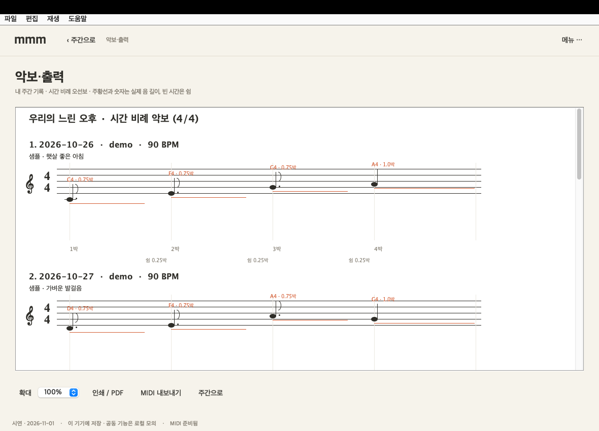

- 컴포넌트: JButton ×5, JComboBox ×1, JFrame ×1, JLabel ×7, JMenu ×4, JMenuBar ×1, JPanel ×9, JProgressBar ×1, JScrollPane ×1
- 앱 코드가 등록한 이벤트: ActionListener ×7, KeyListener ×1, MouseListener ×1, WindowFocusListener ×1, WindowListener ×1
- 배치 관리자: AquaComboBoxLayoutManager, BorderLayout, BoxLayout, CardLayout, FlowLayout, GridBagLayout, RootLayout, UIResource, ViewportLayout

## S12 실제 구성

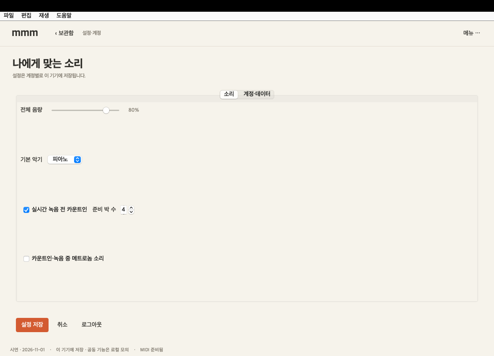

- 컴포넌트: JButton ×5, JCheckBox ×2, JComboBox ×1, JFrame ×1, JLabel ×10, JMenu ×4, JMenuBar ×1, JPanel ×14, JProgressBar ×1, JSlider ×1, JSpinner ×1, JTabbedPane ×1, JTextArea ×1, JTextField ×1
- 앱 코드가 등록한 이벤트: ActionListener ×6, ChangeListener ×1, KeyListener ×1, MouseListener ×1, WindowFocusListener ×1, WindowListener ×1
- 배치 관리자: AquaComboBoxLayoutManager, AquaTruncatingTabbedPaneLayout, BorderLayout, BoxLayout, CardLayout, FlowLayout, GridBagLayout, NumberEditor, RootLayout, SpinnerLayout, UpdateHandler

## S13 실제 구성

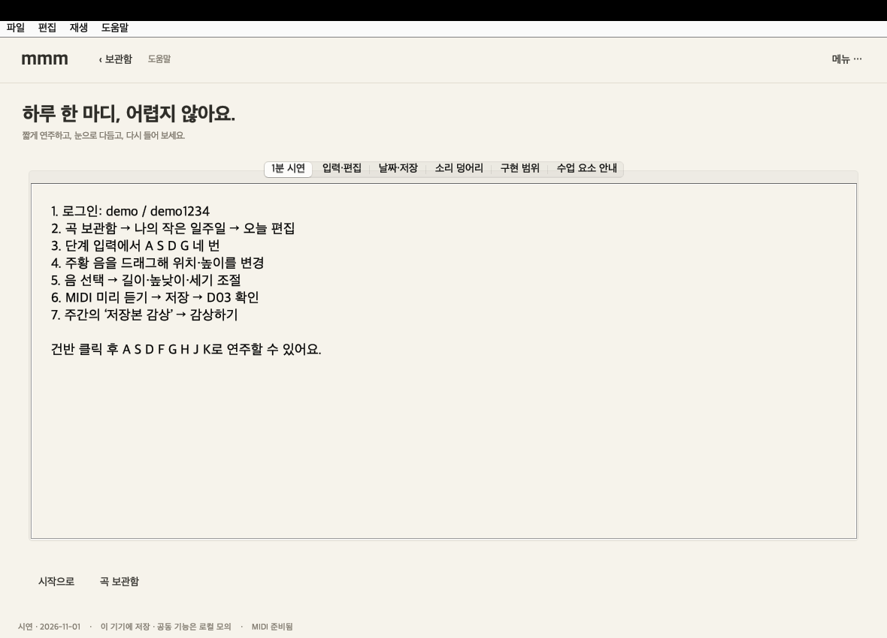

- 컴포넌트: JButton ×4, JEditorPane ×1, JFrame ×1, JLabel ×7, JMenu ×4, JMenuBar ×1, JPanel ×9, JProgressBar ×1, JScrollPane ×7, JSplitPane ×1, JTabbedPane ×1, JTextArea ×5, JTree ×1
- 앱 코드가 등록한 이벤트: ActionListener ×5, HyperlinkListener ×1, KeyListener ×1, MouseListener ×1, TreeSelectionListener ×1, WindowFocusListener ×1, WindowListener ×1
- 배치 관리자: AquaTruncatingTabbedPaneLayout, BasicHorizontalLayoutManager, BorderLayout, BoxLayout, CardLayout, DividerLayout, FlowLayout, GridBagLayout, RootLayout, UIResource, UpdateHandler, ViewportLayout

## S14 실제 구성

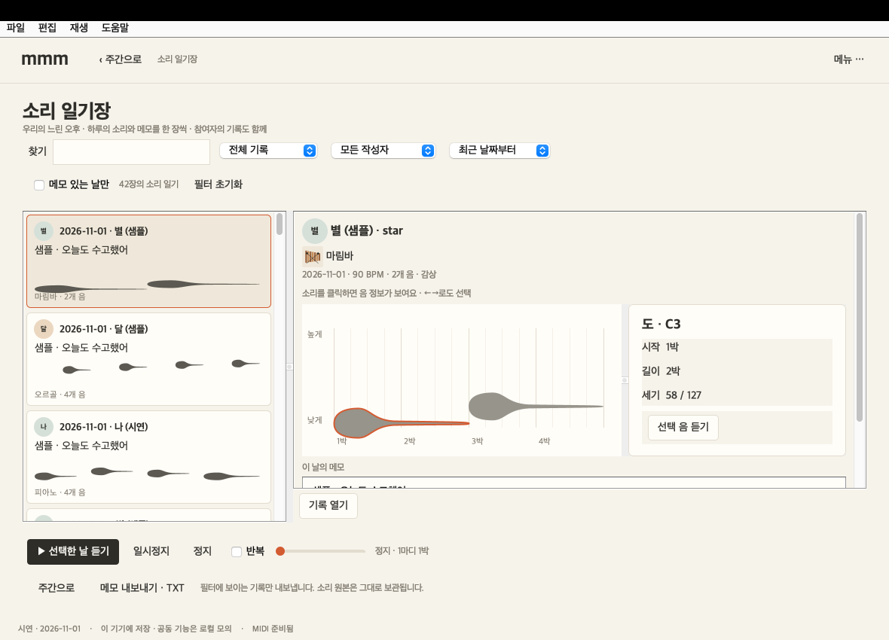

- 컴포넌트: JButton ×10, JCheckBox ×2, JComboBox ×3, JFrame ×1, JLabel ×19, JLabel(ImageIcon) ×2, JList ×1, JMenu ×4, JMenuBar ×1, JPanel ×24, JProgressBar ×1, JScrollPane ×4, JSlider ×1, JSplitPane ×2, JTable ×1, JTextField ×1, JTextPane ×1, JToggleButton ×1
- 앱 코드가 등록한 이벤트: ActionListener ×12, ChangeListener ×1, DocumentListener ×1, ItemListener ×5, KeyListener ×1, ListSelectionListener ×2, MouseListener ×3, WindowFocusListener ×1, WindowListener ×1
- 배치 관리자: AquaComboBoxLayoutManager, BasicHorizontalLayoutManager, BorderLayout, BoxLayout, CardLayout, DividerLayout, FlowLayout, GridBagLayout, GridLayout, RootLayout, UIResource, UpdateHandler, ViewportLayout
