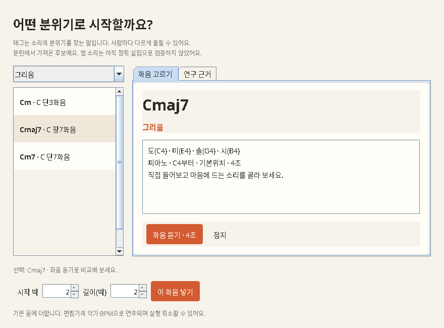

# 음음음 · 감정으로 화음 찾기

이 문서는 **화음에 관한 연구 근거를 실제 Java 편집 기능에 연결하는 방법**을 설명합니다. 음악 용어를 모르는 사용자가 원하는 분위기로 후보 화음을 찾아 듣고, 마음에 드는 소리를 자신의 한 마디에 넣도록 돕는 기능입니다.

감정 태그는 **음악에서 지각되는 분위기를 찾는 기준**입니다. 사용자의 현재 감정을 판정하거나, 특정 화음을 들으면 그 감정이 생긴다고 보장하는 값이 아닙니다. 연구에서 보고한 평균과 음음음에서 만든 소리 샘플도 구분합니다.

문서 기준일: 2026-11-23. JDK 21 빌드에서 기존 자동 검사 101개와 신규 `EmotionCatalogTest`의 206개 assertion 통과를 확인했습니다. 화면·편집기 통합 검증의 최신 상태는 [VALIDATION.md](VALIDATION.md)를 기준으로 합니다.

## 먼저 읽을 문서

| 문서 | 답하는 질문 |
|---|---|
| 이 문서 | 기능이 어떻게 동작하고 어느 파일을 수정해야 하나요? |
| [CRITERIA.md](CRITERIA.md) | 어떤 화음과 감정을 연결했고, 어떤 표현은 보류했나요? |
| [SOURCES.md](SOURCES.md) | 근거 논문은 무엇이며 각 논문이 어디까지 뒷받침하나요? |
| [VALIDATION.md](VALIDATION.md) | 소프트웨어 동작과 실제 청취 평가를 어떻게 확인하나요? |



## 1. 이번 기능의 범위

카탈로그에는 **화음 7개, 사용 가능한 감정 태그 5개, 직접 근거를 연결한 후보 관계 9개**를 둡니다.

- 태그: **기쁨, 슬픔, 그리움, 긴장감, 긍정적인**.
- 화음: **C, Cm, Cmaj7, Cm7, Caug, Cdim, C7**.
- 카탈로그의 후보 관계는 문헌에 연결된 탐색 출발점입니다. 감정의 정답, 추천 확률, 사용자의 감정 점수가 아닙니다.
- 실제 음음음 소리 샘플에 대한 자체 청취 검증은 아직 수행하지 않았습니다.

기존의 **연주 → 시각 편집 → 들어보기 → 저장 → 다시 듣기** 흐름에서, 화음 고르기는 연주·편집 단계의 선택 수단으로 들어갑니다. 사용자는 선택한 화음을 넣은 뒤 다른 음과 동일하게 높이·길이·세기를 편집할 수 있습니다.

## 2. Mac에서 검토하기

기존 앱과 동일하게 **Java 21 이상 JDK**가 필요합니다. 이 문서는 사용자의 Mac에서 창을 열거나 청취를 마쳤다는 기록이 아닙니다.

저장소 루트에서 실행합니다.

```sh
./app/review-emotions.command
```

검토 스크립트는 빌드 후 Mac에서 문서 폴더와 이 README를 TextEdit으로 열고, 독립 화음 탐색 화면을 실행합니다. 스크립트 자체의 최신 실행 결과는 통합 검증 기록과 함께 확인합니다. Finder에서 실행 권한 문제로 열리지 않으면 터미널에서 위 명령을 사용합니다.

이미 빌드한 JAR에서 독립 화면만 열려면 다음과 같이 실행합니다.

```sh
java -cp app/build/MMM.jar mmm.EmotionPalette
```

배포용 검토 JAR `downloads/MMM-emotion-preview.jar`를 받은 경우에는 다음 명령으로 같은 탐색 화면을 열 수 있습니다.

```sh
java -jar downloads/MMM-emotion-preview.jar --emotion-palette
```

이 JAR에도 Java 21 이상이 필요합니다. `--emotion-palette`를 빼면 전체 앱의 기본 진입점으로 실행됩니다.

독립 화면은 **카탈로그·미리 듣기·연구 근거를 검토하는 화면**입니다. 편집기에서 열었을 때의 음 삽입과 실행 취소는 전체 앱에서 확인합니다.

```sh
./app/demo.command
```

전체 앱에서 시연 기록의 **오늘 편집**을 열고 **감정으로 화음 찾기** 버튼을 누릅니다. 편집·저장에 관한 기본 사용법은 [앱 전체 사용법](../../README.md)에 있습니다.

## 3. 화면에서 하는 일

### 화음 고르기

편집기의 **감정으로 화음 찾기** 버튼은 모달 대화상자를 엽니다. 감정 필터는 콤보박스로 제공하며, **화음 고르기** 탭에서 해당 태그와 근거가 연결된 후보를 선택합니다.

1. 원하는 분위기 태그를 선택합니다.
2. 후보 화음을 선택하고 미리 듣습니다.
3. 다른 후보도 들어보며 자신이 표현하려는 느낌과 비교합니다.
4. 편집기에 넣을 시작 박과 길이를 선택합니다.
5. 화음을 넣은 뒤 편집기의 들어보기로 기존 음과 함께 확인합니다.

후보를 보여주는 순서는 논문 평균에 따른 우열이나 개인별 추천 순위를 뜻하지 않습니다. 하나의 화음에 여러 태그가 연결될 수 있습니다.

### 연구 근거

**연구 근거** 탭은 선택한 화음의 근거를 확인하는 곳입니다. 논문 출처, 원문의 측정 차원, 척도, 보고된 평균·표준편차와 적용 한계를 함께 읽습니다.

예를 들어 `평균 2.89 / 5, SD 0.82`는 특정 연구 조건에서 여러 참가자가 준 점수의 요약입니다. `그리울 확률 57.8%`로 바꾸거나, 현재 미리 듣기의 평가 점수로 읽으면 안 됩니다. 구체적인 9개 연결은 [선정 기준](CRITERIA.md)에 정리했습니다.

## 4. 미리 듣기와 편집기 삽입은 재생 조건이 다릅니다

### 후보를 비교하는 미리 듣기

후보 간의 차이를 비교하기 위해 아래 조건을 통일합니다.

| 항목 | 카탈로그 미리 듣기 조건 |
|---|---|
| 근음 | C4, MIDI 60 |
| 음 배치 | 기본위치의 좁은 배치, 화음 구성음 동시 시작 |
| 악기 | General MIDI 프로그램 0, Acoustic Grand Piano |
| 속도 | 60 BPM |
| 길이 | 4박, PPQ 480 기준 1920 tick, 4초 |
| 입력 세기 | `NoteEvent`의 MIDI velocity 72 |

General MIDI 프로그램 번호는 코드에서 사용하는 **0부터 시작하는 값**입니다. 이 문서의 C4는 MIDI 60을 뜻하며, 다른 음악 소프트웨어의 옥타브 표기 관례와 다를 수 있습니다.

이 조건은 **음음음이 비교용으로 정한 구현 조건**입니다. 논문 실험 음원의 복제 조건이 아닙니다. 입력 velocity 72에는 기존 MIDI 엔진의 전체 음량 설정이 적용되므로 실제 출력 이벤트의 세기는 달라질 수 있습니다. 운영체제와 설치된 MIDI 사운드뱅크에 따라 같은 프로그램 번호의 실제 음색도 달라집니다. 후보들의 물리적인 음압이나 지각된 크기를 정규화한 것은 아닙니다. 자체 청취 평가를 할 때에는 전체 음량 설정, 기기, 신시사이저·사운드뱅크와 재생 환경을 기록합니다.

### 편집기에 넣은 뒤

삽입 시에는 선택한 구성음을 같은 시작 시점에 배치하며, 사용자가 고른 시작 박과 길이를 사용합니다. 재생에는 **현재 편집기의 악기와 BPM**이 적용됩니다. 예를 들어 4박 길이도 120 BPM에서는 2초이므로, 카탈로그에서 들은 4초 샘플과 항상 같은 소리가 되지는 않습니다.

한 번의 화음 삽입은 구성음 전체를 **하나의 실행 취소 작업**으로 묶습니다. 한 번 취소하면 그 삽입으로 추가한 음 전체가 돌아가야 합니다. 기존 음에 화음을 더할 때는 마디 범위와 음 개수 제한을 검사하고, 실패하면 일부 구성음만 남기지 않아야 합니다.

## 5. 어떤 자료를 저장하나요?

이 기능에는 서로 다른 두 종류의 자료가 있습니다.

| 구분 | 저장하는 내용 | 역할 |
|---|---|---|
| 연구 카탈로그 | 태그, 논문, 근거, 화음 샘플, 연결 관계, 미리 듣기 설정 | 앱에 함께 배포하는 읽기 자료 |
| 사용자의 한 마디 | 기존 `Phrase.notes`의 음높이·시작·길이·세기 등 | 사용자가 편집하고 저장하는 음악 |

화음을 삽입하면 구성음이 기존 `NoteEvent`들로 들어갑니다. 기존 `Phrase.notes` 저장 형식은 유지합니다. 이 변경으로 사용자의 감정, 선택한 감정 태그, 감정 추론 결과를 사용자 기록에 새로 저장하지 않습니다.

연구 평균은 카탈로그의 출처 정보이고 사용자 기록의 점수가 아닙니다. 태그 선택 이력을 모아 개인별 감정을 예측하는 기능도 이번 범위에 포함하지 않습니다.

## 6. 파일 구성과 역할

아래 경로는 저장소 루트 기준입니다.

| 파일 | 역할 |
|---|---|
| `app/src/main/java/mmm/EmotionCatalog.java` | 텍스트 자료를 타입이 있는 카탈로그로 읽고 관계·값을 검증 |
| `app/src/main/java/mmm/EmotionPalette.java` | 화음 고르기·연구 근거 탭, 미리 듣기, 모달/독립 화면에서 재사용하는 Swing 패널 |
| `app/src/main/java/mmm/EditorPanel.java` | 진입 버튼, 시작 박·길이를 반영한 삽입, 기존 실행 취소 흐름과 연결 |
| `app/resources/mmm/emotion/catalog.properties` | 스키마 버전, 문헌 기반 자료임을 나타내는 종류, 검토일, 청취 검증 상태 |
| `app/resources/mmm/emotion/tags.tsv` | 감정 태그와 사용/보류 상태 |
| `app/resources/mmm/emotion/sources.tsv` | 논문 식별 정보·DOI·실험 범위·적용 한계 |
| `app/resources/mmm/emotion/evidence.tsv` | 원문 측정 차원·척도·보고값·집계 조건·결과 위치 |
| `app/resources/mmm/emotion/chords.tsv` | 재생 가능한 화음 샘플의 구성음·악기·속도·길이·입력 세기·검증 상태 |
| `app/resources/mmm/emotion/links.tsv` | 태그·근거·화음의 연결 |
| `app/review-emotions.command` | 빌드·문서 폴더·독립 검토 화면 진입점 |
| `app/test-emotions-gui.sh` | 감정 화음 기능의 Swing 통합 검사 진입점 |
| `app/src/test/java/mmm/EmotionCatalogTest.java` | 카탈로그 값·관계·불변 조건을 확인하는 자동 검사 |
| `app/src/test/java/mmm/EmotionGuiTest.java` | 실제 Swing에서 탐색·근거·삽입·취소 등을 확인하는 통합 검사 |
| `app/docs/emotion/` | 이 문서와 선정 기준·출처·검증 계획 |

`TSV`는 탭으로 열을 구분하는 UTF-8 텍스트 표입니다. 논문 본문이나 논문의 오디오 파일을 통째로 저장한 자료가 아닙니다. 각 파일의 실제 첫 줄에 있는 열 이름을 기준으로 수정합니다.

## 7. 개발자가 자료를 추가하는 순서

1. **근거를 읽습니다.** 어떤 음악 단위를 실험했는지, 무엇을 질문했는지, 어떤 참가자를 대상으로 했는지 확인합니다. 단일 화음 연구와 곡 전체 연구는 구분합니다.
2. **출처를 등록합니다.** `sources.tsv`에 전체 서지와 DOI를 넣고 기존 출처와 중복되는지 확인합니다.
3. **근거를 등록합니다.** `evidence.tsv`에 원문의 측정 차원·척도·보고값·집계 조건·결과 위치를, `sources.tsv`에 연구 범위와 한계를 기록합니다. 논문에 없는 수치를 계산해 원문값처럼 저장하지 않습니다.
4. **화음 샘플을 정합니다.** `chords.tsv`에 실제 재생할 음을 등록합니다. 같은 코드 종류라도 음역·전위·음색이 달라지면 샘플 조건을 구분합니다.
5. **연결을 추가합니다.** `links.tsv`에서 태그·근거·화음을 연결합니다. 태그의 해석이나 번역이 검토 중이면 사용 가능한 후보로 노출하지 않습니다.
6. **검증합니다.** 자료 로드, 참조 관계, 미리 듣기, 편집기 삽입·취소를 확인합니다. 새 태그의 청취 타당성은 별도의 사용자 평가로 확인합니다.

신규 태그를 넣는 작업은 화면에 단어 하나를 추가하는 것으로 끝나지 않습니다. 해당 단어가 원문 차원과 어떻게 연결되는지, 실제 음음음 음원에서도 사용자가 그 인상을 받는지를 설명할 수 있어야 합니다.

### 현재 스키마의 의도적인 제한

현재 `schema_version=1.0.0` 로더는 등록된 화음 종류·측정 차원과 **독립 화음(`standalone`), 기본위치(`root_position`), 좁은 배치(`close`), 자체 미검증(`not_validated`), 원본 자극과 다름(`not_equivalent`)**이라는 상태를 검사합니다. 사용 가능한 태그에는 측정 차원이 일치하는 수치 근거와 직접 후보 연결이 필요합니다.

전위·코드 진행·새 측정 차원을 추가하거나 자체 청취 검증 상태를 바꾸는 일은 TSV 수정만으로 끝나지 않습니다. **스키마 버전, `EmotionCatalog`의 타입·검증 규칙, 자동 검사, 관련 문서**를 함께 변경해야 합니다. 후속 청취 조사값은 기존 논문 보고값을 덮어쓰지 않고 새로운 근거 종류와 조사 버전을 지원하도록 모델을 확장한 뒤 추가합니다.

## 8. 발표에서 설명할 수 있는 구현 결정

“음음음은 음악에서 지각되는 감정적 인상에 관한 선행연구를 바탕으로, 사용자가 분위기 언어로 화음 후보를 탐색하도록 설계했습니다. 연구의 측정값과 실제 앱 샘플을 구분해 출처·조건·한계를 제공하고, 사용자가 직접 들은 뒤 선택한 화음을 기존 한 마디 편집 흐름에 넣습니다. 현재 태그는 문헌 기반 후보이며 앱의 재생음에 대한 자체 청취 검증은 후속 단계입니다.”

이 설명은 현재의 기능 범위와 검증 상태를 나타냅니다. 자체 청취 조사가 끝나면 조사 대상·재생 조건·평가 문항·결과를 [VALIDATION.md](VALIDATION.md)에 추가한 뒤 표현을 갱신합니다.
